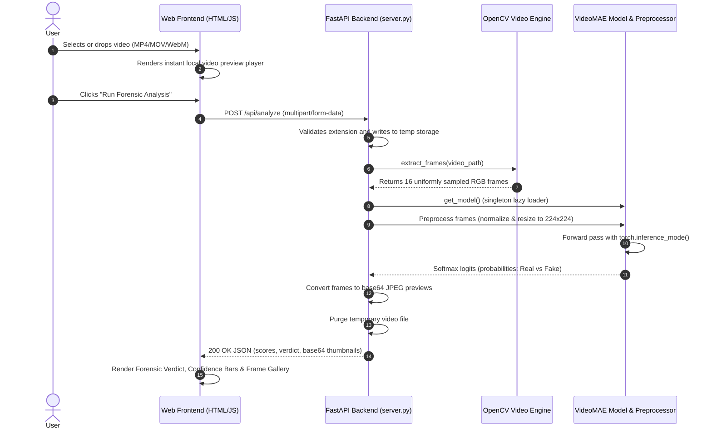

# Deepfake Video Forensics — Video Analyser

[](https://www.python.org/)
[](https://pytorch.org/)
[](https://fastapi.tiangolo.com/)
[](https://huggingface.co/)
[](https://opencv.org/)
[](#-license--intellectual-property)

**Deepfake Video Forensics** is an enterprise-grade AI media verification platform engineered to detect facial deepfakes, AI reenactments, and temporal video manipulations. Powered by a specialized **VideoMAE (Video Masked Autoencoder)** vision transformer fine-tuned on the **FaceForensics++** benchmark, the system inspects both spatial facial structures and cross-frame temporal motion signatures to uncover synthetic artifacts invisible to single-frame image detectors.

---

## 📑 Table of Contents

1. [System Overview & Architecture](#-system-overview--architecture)
2. [Key Features](#-key-features)
3. [End-to-End Pipeline Workflow](#-end-to-end-pipeline-workflow)
4. [Project Structure](#-project-structure)
5. [Prerequisites & System Requirements](#-prerequisites--system-requirements)
6. [Quick Start: 1-Line Setup & 1-Line Run](#-quick-start-1-line-setup--1-line-run)
7. [Manual Step-by-Step Setup](#-manual-step-by-step-setup-optional)
8. [Testing & Verification](#-testing--verification)
9. [REST API Reference & Examples](#-rest-api-reference--examples)
10. [Model Architecture & Specifications](#-model-architecture--specifications)
11. [Troubleshooting & Common Issues](#-troubleshooting--common-issues)
12. [License & Intellectual Property](#-license--intellectual-property)

---

## 🧠 System Overview & Architecture

Standard deepfake detectors evaluate isolated individual video frames. This creates high vulnerability to false positives and misses temporal inconsistencies like flickering, warped facial contours between frames, blinking glitches, and boundary blending jitter.

**Deepfake Video Forensics** resolves this through **spatiotemporal self-attention**:
- **Temporal Dynamics**: Simultaneously ingests a 16-frame temporal tubelet representation across the video duration.
- **Deep Feature Representation**: Leverages 12 transformer encoder layers with 12 attention heads each, extracting 768-dimensional latent representations.
- **Strict Privacy**: Entirely self-contained. Executes 100% offline with zero cloud telemetry or third-party data egress.

```
┌─────────────────┐       ┌──────────────────────┐       ┌────────────────────────┐
│  User Video     │ ───►  │  FastAPI REST Server │ ───►  │  OpenCV Timeline       │
│  (MP4/MOV/WebM) │       │  (Port 8000)         │       │  Frame Extraction (16) │
└─────────────────┘       └──────────────────────┘       └───────────┬────────────┘
                                                                     │
┌─────────────────────────┐       ┌────────────────────────┐         │
│  Interactive Glassmorphic│ ◄───  │  Softmax Probabilities │ ◄───────┘
│  Forensic Report UI     │       │  & VideoMAE Classifier │
└─────────────────────────┘       └────────────────────────┘
```

---

## ✨ Key Features

- **🧠 Spatiotemporal VideoMAE Classifier**: Fine-tuned on the FaceForensics++ benchmark (C23 compression) to detect deepfake synthesis and facial reenactment.
- **⚡ Dual Hardware Acceleration**: Automatically detects NVIDIA CUDA GPUs; seamlessly falls back to optimized multi-threaded CPU execution if a GPU is absent.
- **🎨 Glassmorphic Dark-Mode Interface**:
  - Drag-and-drop video upload with file validation.
  - In-browser instant video preview player with custom controls.
  - Dynamic Real vs. Fake confidence progress meters.
  - Interactive gallery of the 16 sampled frames extracted across the video timeline.
- **🚀 High-Performance Asynchronous Backend**: FastAPI REST backend handling multipart streams and memory-efficient temporary file processing.
- **🔒 Zero Cloud Ingestion (Air-Gapped Ready)**: Operates entirely locally on your host machine or private cloud.

---

## 🔄 End-to-End Pipeline Workflow



---

## 📂 Project Structure

```text
deepfakevideoanalyser/
├── setup.js                    # 1-Line cross-platform setup orchestrator
├── setup.bat                   # 1-Click Windows setup script
├── setup.sh                    # 1-Click macOS/Linux setup script
├── run.js                      # 1-Line startup orchestrator (ports, servers, auto-open)
├── start.bat                   # 1-Click Windows launcher
├── start.sh                    # 1-Click macOS/Linux launcher
├── server.py                   # FastAPI REST backend & inference runner
├── app.py                      # Production entrypoint & Hugging Face Spaces handler
├── package.json                # Project scripts (npm run setup, npm start, etc.)
├── requirements.txt            # Python AI & computer vision dependencies
├── Dockerfile                  # Containerized deployment manifest
├── frontend/                   # Client-side web interface
│   ├── index.html              # Semantic HTML5 glassmorphic structure
│   ├── style.css               # Dark-mode styling, animations, confidence meters
│   └── app.js                  # Frontend controller, API bridge, UI state management
├── models/
│   └── videomae/               # Trained model package
│       ├── config.json         # VideoMAE architecture parameters & id2label mapping
│       ├── preprocessor_config.json # 16-frame spatial preprocessor parameters
│       ├── model.safetensors   # Fine-tuned model weights (~329 MB)
│       └── README.md           # Detailed model card & training benchmarks
└── README.md                   # End-to-end project documentation
```

### Key Components

- **[`quickstart.py`](quickstart.py)**: Zero-dependency standalone Python bootstrapper that creates `.venv`, installs dependencies, downloads VideoMAE weights, launches the web studio on port 8000, and opens your browser in a single command.
- **[`setup.bat`](setup.bat) / [`start.bat`](start.bat)**: Windows 1-click launchers (auto-detects Python or Node).
- **[`setup.sh`](setup.sh) / [`start.sh`](start.sh)**: Unix/macOS 1-click shell scripts.
- **[`setup.js`](setup.js) / [`run.js`](run.js)**: Node.js orchestrators for dual-engine Vite (`:5173`) + FastAPI (`:8000`) development.
- **[`server.py`](server.py)**: Initializes FastAPI, mounts `/static` for frontend assets, routes `/api/health` and `/api/analyze`, manages model caching, runs OpenCV frame sampling, and executes PyTorch inference.
- **[`models/videomae/`](models/videomae/)**: Contains the complete self-contained VideoMAE model weights (`model.safetensors`) and Hugging Face configuration files.
- **[`frontend/app.js`](frontend/app.js)**: Handles client-side drag-and-drop, validates file size, issues async fetch calls to `/api/analyze`, and renders the interactive forensic report.
- **[`test_model.py`](test_model.py)**: Standalone diagnostic utility to verify model load time, weight integrity, and compute device without launching the web server.

---

## 🛠️ Prerequisites & System Requirements

### Minimum Requirements
- **Operating System**: Windows 10/11, macOS 12+, or Linux (Ubuntu 20.04+)
- **Python**: Version 3.10, 3.11, 3.12, or 3.13
- **Memory (RAM)**: 4 GB minimum (8 GB recommended)
- **Disk Space**: ~1.5 GB free space (including model weights and environment)

### GPU Acceleration (Optional, Recommended for Fast Inference)
- **GPU**: NVIDIA GPU with Compute Capability 6.0+ (GTX 1060 or newer, RTX series)
- **CUDA**: CUDA 11.8 or 12.1+ with matching PyTorch build

---

## ⚡ Quick Start: 1-Command Setup & Run

### 🚀 Recommended: Zero-Config Standalone Quickstart (Python 3.10+)
If you just cloned the repository with only Python installed (no Node.js required):

```bash
python quickstart.py
```

> **Windows 1-Click:** Double-click `start.bat` or `setup.bat`  
> **macOS / Linux 1-Click:** Run `./start.sh` or `./setup.sh`

This single command automatically:
1. Checks Python 3.10+ version compatibility
2. Creates an isolated `.venv` virtual environment
3. Installs all PyTorch, OpenCV, Transformers, and FastAPI dependencies
4. Verifies and downloads fine-tuned VideoMAE model weights (~329 MB)
5. Starts the unified web studio on `http://127.0.0.1:8000/` and opens your browser.

---

### 📦 Dual-Engine Development Mode (Node.js + Python)
For full Vite Hot Module Replacement (HMR) development on port `5173`:

#### 1️⃣ One-Line Installation (Run Once)
```bash
npm run setup
```

#### 2️⃣ One-Line Run (Launch Application)
```bash
npm start
```

---

### 🌐 Live Local Access Links
Once launched, you can immediately access:
- **Interactive Forensic Studio (Frontend)**: [http://127.0.0.1:5173/](http://127.0.0.1:5173/)
- **FastAPI Backend (Direct Root)**: [http://127.0.0.1:8000/](http://127.0.0.1:8000/)
- **Interactive Swagger Documentation**: [http://127.0.0.1:8000/docs](http://127.0.0.1:8000/docs)
- **Engine Health & Telemetry**: [http://127.0.0.1:8000/api/health](http://127.0.0.1:8000/api/health)

---

### 🛠️ Manual Step-by-Step Setup (Optional)

If you prefer to configure your environment manually:

#### 1. Clone the Repository
```bash
git clone <repository-url>
cd deepfakevideoanalyser
```

#### 2. Install Node.js Frontend Dependencies
```bash
npm install
```

#### 3. Set Up Python Virtual Environment

##### Windows (PowerShell):
```powershell
python -m venv .venv
.\.venv\Scripts\Activate.ps1
```

##### macOS / Linux:
```bash
python3 -m venv .venv
source .venv/bin/activate
```

#### 4. Install Python Dependencies
```bash
pip install -r requirements.txt
```

> **⚡ NVIDIA CUDA GPU Acceleration**:
> To enable hardware GPU acceleration with an NVIDIA GPU, install the CUDA-enabled PyTorch build:
> ```bash
> pip install torch torchvision --index-url https://download.pytorch.org/whl/cu121
> ```

#### 5. Model Weights
Weights (`model.safetensors`, ~345MB) are automatically downloaded from Hugging Face (`Vansh180/VideoMae-ffc23-deepfake-detector`) into `models/videomae/` on first run of `npm run dev`, `server.py`, or `test_model.py`.

---

## 🧪 Testing & Verification

Run the sanity check script to verify model loading:

```bash
python test_model.py
```

Expected output:
```text
Verifying model weights...
Loading processor...
Loading model...
Model loaded successfully!
Device: cpu (or cuda)
Labels: {0: 'real', 1: 'fake'}
```

---

## 🏃 Running the Application

### One-Command Quick Start (Frontend + Backend)

```bash
npm run dev
```

This single command will:
1. Verify and automatically install Node and Python dependencies.
2. Verify / auto-download fine-tuned VideoMAE model weights.
3. Launch the FastAPI Python Backend on `http://127.0.0.1:8000`.
4. Launch the Vite Frontend on `http://127.0.0.1:5173`.

### Access Links
* **Frontend Web Application**: [http://127.0.0.1:5173/](http://127.0.0.1:5173/)
* **Backend API & Swagger Docs**: [http://127.0.0.1:8000/docs](http://127.0.0.1:8000/docs)

### Individual Services (Advanced)
- **Backend Only**: `npm run dev:backend` (or `python server.py`)
- **Frontend Only**: `npm run dev:frontend` (or `npx vite`)

### Accessing the Web Interface
- **Via Vite Dev Server (Hot-Reloading)**: 👉 **[http://127.0.0.1:5173](http://127.0.0.1:5173)** *(automatically proxies all `/api` calls to the FastAPI backend)*
- **Direct via FastAPI Server**: 👉 **[http://127.0.0.1:8000](http://127.0.0.1:8000)**


---

## 🔌 REST API Reference & Examples

### 1. Health & Compute Device Check
Checks server health, active compute hardware (`cuda` or `cpu`), and model status.

- **Endpoint**: `GET /api/health`
- **cURL Request**:
  ```bash
  curl -X GET http://127.0.0.1:8000/api/health
  ```
- **Response (`200 OK`)**:
  ```json
  {
    "status": "ok",
    "device": "cpu",
    "model_path": "F:\\05.Client_project\\deepfakevideoanalyser\\models\\videomae",
    "model_ready": true
  }
  ```

---

### 2. Video Forensic Analysis
Uploads a video file, extracts 16 evenly spaced timeline frames, runs VideoMAE classification, and returns forensic confidence scores and sampled thumbnails.

- **Endpoint**: `POST /api/analyze`
- **Content-Type**: `multipart/form-data`
- **Supported Formats**: `.mp4`, `.mov`, `.webm` (up to 250 MB)
- **cURL Request**:
  ```bash
  curl -X POST "http://127.0.0.1:8000/api/analyze" \
       -H "accept: application/json" \
       -H "Content-Type: multipart/form-data" \
       -F "file=@path/to/sample_video.mp4"
  ```
- **Response (`200 OK`)**:
  ```json
  {
    "results": [
      { "label": "real", "score": 0.8924 },
      { "label": "fake", "score": 0.1076 }
    ],
    "frames": [
      "data:image/jpeg;base64,/9j/4AAQSkZJRg...",
      "data:image/jpeg;base64,/9j/4AAQSkZJRg..."
    ],
    "device": "cpu",
    "frames_sampled": 16
  }
  ```

---

### 3. Python Integration Example
Run video classification directly from an external Python script:

```python
import requests

url = "http://127.0.0.1:8000/api/analyze"
video_path = "sample_test.mp4"

with open(video_path, "rb") as f:
    files = {"file": (video_path, f, "video/mp4")}
    response = requests.post(url, files=files)

data = response.json()
print("Top Verdict:", data["results"][0]["label"].upper())
print("Confidence:", f"{data['results'][0]['score'] * 100:.2f}%")
print("Compute Device:", data["device"])
```

---

## 📊 Model Architecture & Specifications

| Parameter | Specification |
|---|---|
| **Base Architecture** | `VideoMAEForVideoClassification` (Vision Masked Autoencoder) |
| **Input Shape** | 16 frames × 3 channels × 224 height × 224 width |
| **Patch Size & Tubelet** | 16 × 16 spatial patches, 2-frame tubelet size |
| **Hidden Layers** | 12 Transformer Encoder layers |
| **Attention Heads** | 12 heads (Hidden size: 768) |
| **Training Benchmark** | FaceForensics++ (C23 compression) |
| **Training Infrastructure** | Amingo In-House High-End GPU Workstation |
| **Evaluation Accuracy** | **88.0%** |
| **Evaluation F1-Score** | **0.742** |
| **Evaluation AUC** | **0.836** |
| **Weights Size** | ~328 MB (`model.safetensors`) |

---

## ❓ Troubleshooting & Common Issues

### 1. `[WinError 10013] an attempt was made to access a socket in a way forbidden by its access permissions`
- **Cause**: On Windows machines, port `8080` is frequently claimed by system services (such as `AgentService.exe`), Windows NAT, or Hyper-V reserved port ranges.
- **Solution**: Use port `8000` (or another free port like `8001`, `8088`):
  ```powershell
  .\.venv\Scripts\python.exe -m uvicorn server:app --host 127.0.0.1 --port 8000 --reload
  ```

### 2. `Could not open this video. Try an MP4 file.`
- **Cause**: The uploaded video is corrupt, empty, or encoded in a codec unsupported by the local OpenCV backend.
- **Solution**: Convert the video to standard H.264/AAC MP4:
  ```bash
  ffmpeg -i input_video.mov -vcodec libx264 -acodec aac fixed_video.mp4
  ```

### 3. Server runs on `CPU` instead of `CUDA`
- **Cause**: PyTorch was installed without CUDA support or NVIDIA drivers are missing.
- **Check**: Run `python -c "import torch; print(torch.cuda.is_available())"`. If `False`, reinstall PyTorch with CUDA:
  ```powershell
  pip install --force-reinstall torch torchvision --index-url https://download.pytorch.org/whl/cu121
  ```

### 4. `File exceeds 250MB size limit`
- **Cause**: The client interface limits video uploads to 250MB for responsive local analysis.
- **Solution**: Trim the clip to a 5–30 second segment before uploading. Because the engine samples 16 uniform frames across the clip timeline, a 10-second segment provides high forensic coverage.

---

## 📜 License & Intellectual Property

This project, source code, and fine-tuned model weights are proprietary and developed under **Deepfake Video Forensics**. All rights reserved.

- **Model Delivery**: Shipped as optimized inference weights (`model.safetensors`). Raw benchmark datasets (100+ GB) remain private to protect proprietary training pipelines.
- **Usage**: Unauthorized duplication, external distribution, or commercial reuse without explicit authorization is strictly prohibited.
